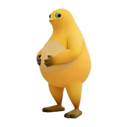
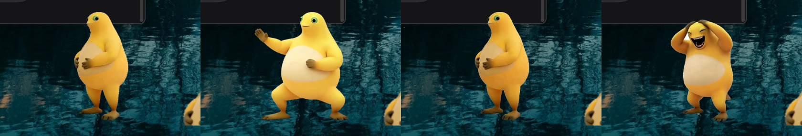
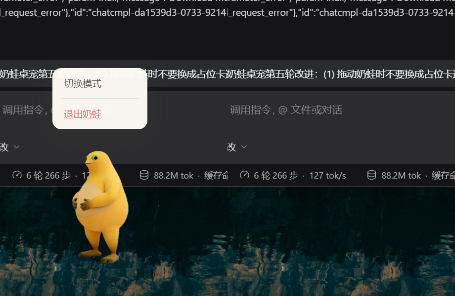

<div align="center">



# 奶蛙桌宠 · Naiwa Desktop Pet

**你也想在电脑养一只可爱的奶蛙吗**

一只住在 Windows 桌面上的奶蛙。点它就笑，连点会分身跟着一起笑；工作的时候它会记便签和剪贴板。



[⬇️ 下载](#-下载安装) · [怎么玩](#-怎么玩) · [常见问题](#-常见问题) · [从源码运行](#-从源码运行)

</div>

---

## 📥 下载安装

到 **[Releases 页面](../../releases/latest)** 下载最新版，两个文件二选一：

| 文件 | 适合谁 | 说明 |
| --- | --- | --- |
| **`naiwa-desktop-pet-1.0.0-setup.exe`** | 大多数人 | **安装版**：双击 → 下一步 → 装完自动启动，桌面和开始菜单会有「奶蛙桌宠」 |
| **`naiwa-desktop-pet-1.0.0-portable.exe`** | 想先试试 / 放 U 盘 | **免安装版**：单文件，双击就跑，不写注册表，删掉文件即卸载 |

安装完奶蛙会出现在**主屏右下角**。它**不在任务栏显示**，常驻在托盘。

### ⚠️ 第一次运行会被 Windows 拦一下（正常现象）

这个程序**没有买代码签名证书**（个人开源项目一年几百刀，不划算），所以：

- **蓝色提示「Windows 已保护你的电脑」** → 点「更多信息」→「仍要运行」
- **杀毒软件报毒 / 拦截** → 加入信任即可。Electron 打包的未签名程序被误报是行业常态，不是真的有病毒

### 系统要求

- **Windows 10 / 11（64 位）** —— 透明窗口、点击穿透、全局光标都用的 Windows 行为，没做 macOS / Linux 适配
- 约 500 MB 内存（Chromium 的底盘；奶蛙自身只占其中一小部分）

---

## 🎮 怎么玩

| 操作 | 效果 |
| --- | --- |
| **左键点击** | 解压模式 → 捧腹大笑（整段 15.4 秒，带原生笑声）；工作模式 → 开合面板 |
| **左键快速连点** | 2.6 秒内点满 4 次 → 左右各分裂一个分身，**三个严格同帧一起笑**，笑完淡出 |
| **按住拖动** | 把奶蛙拖到屏幕任意位置（拖动时保持姿势不变） |
| **右键单击** | 弹出操作窗：切换模式 / 打开面板（仅工作模式）/ **退出奶蛙** |
| **右键双击** | 切换模式 |
| **托盘图标单击** | 显示 / 隐藏奶蛙 |
| **托盘图标右键** | 切换模式、开关剪贴板记录、开关 CPU 监控、打开数据目录、**退出奶蛙** |



> 鼠标移到奶蛙身上，它会看着你（占位素材支持瞳孔跟随；换成真实素材后，视线要画进素材里）。

### 🎈 解压模式

- **待机就是静止的一张图** —— 不做呼吸、摇摆之类的循环动作（这是刻意设计的：常驻桌面，动来动去很烦）
- 点一下 → 15.4 秒整段大笑 + **源视频的原生音轨**（不是合成的电子音）
- 防连点冷却 240ms：低于这个间隔的点击直接丢弃，否则声音会叠成一片噪音，而且笑到一半重头开始很出戏
- 2.6 秒内点满 4 次 → 分身表演：三个实例严格同帧，音效只播一次（三个同时出声会糊成一团）
- 连点到第 3、7、11… 次时随机冒一句台词，不是每次都冒

### 💼 工作模式

**便签 / 待办**
- 点开面板就能写，`Ctrl + Enter` 保存；勾选完成时打勾 + 完声音效 + 奶蛙笑一下（用大笑素材的 1.8 秒短版，不会把你锁在面板外十几秒）

**剪贴板历史**
- 后台自动记录、自动去重（重复内容只移到最前）；点任意一条直接复制回剪贴板
- 支持搜索、置顶（★）；置顶项在「清空」时会保留；默认保留 200 条

**CPU 监控**
- 每 2 秒采样一次；超过 75% 开始流汗，跌到 62% 以下才停（留了滞后区间，避免阈值上反复闪）
- 面板底部有实时 CPU 徽标

---

## ❓ 常见问题

**双击后什么都没出现？**

按顺序排查（这三条覆盖了实际遇到过的全部情况）：

1. **看右下角托盘有没有奶蛙图标** —— 它可能已经在跑了。奶蛙是托盘常驻程序，**关掉窗口不等于退出**。
2. **弹了「奶蛙已经在运行」？** → 托盘右键 →「退出奶蛙」，或者到任务管理器结束残留进程；实在杀不掉就重启系统。
3. **弹了「数据目录没有写入权限」？** → 按提示处理（多半是安全软件或目录权限）。想先跑起来：设环境变量 `NAIWA_ALLOW_MULTI=1` 再启动。
4. 还不行的话，给快捷方式加上 `--no-sandbox` 参数再试（部分安全软件/受限环境会拦掉 Chromium 沙箱）：
   ```bat
   "C:\Users\你的用户名\AppData\Local\Programs\Naiwa Desktop Pet\Naiwa Desktop Pet.exe" --no-sandbox
   ```

**怎么退出？** 托盘图标右键 →「退出奶蛙」，或者直接在奶蛙身上右键 →「退出奶蛙」。

**怎么卸载？** 设置 → 应用 → 奶蛙桌宠 → 卸载（免安装版直接删文件）。想清干净就连 `%APPDATA%\Naiwa Desktop Pet\` 一起删。

**会联网吗？会不会偷偷上传我的剪贴板？** 不会。整个程序**没有任何网络请求**，便签、剪贴板、设置全部存在本地一个 JSON 文件里。剪贴板记录可以在托盘菜单里随时关掉。

**剪贴板历史安全吗？** 它是**明文**存在本地的。复制过密码之类的内容，记得清空，或者干脆关掉记录。

**声音能关吗？** 目前没有单独的静音开关（系统音量里可以调）。要的话可以提 issue。

---

## 🛠 从源码运行

```bash
npm install     # 只装 electron 一个依赖，约 100 MB
npm start
```

**启动后什么都没出现？** 先试 `npm run start:force`；原因和另外两个环境坑见
[`docs/04-项目现状与总交接.md`](docs/04-项目现状与总交接.md) 第 3 节 ——
**那几个坑的共同点是完全没有报错**，不知道的话能查几小时。

---

## 🧪 测试

```bash
npm run check                                  # 素材清单 + 结构自检（不需要 Electron）
npm run probe                                  # 验收探针：布局/时长/台词/菜单/拖拽/退出（约 1 分钟）
npx electron --no-sandbox __smoke.js           # 解压模式冒烟测试
npx electron --no-sandbox __smoke.work.js      # 工作模式冒烟测试（主轮）
```

`__smoke.work.js` 还有三个补充轮，用环境变量切换：

```bash
SMOKE_WORK_CORRUPT=1  npx electron --no-sandbox __smoke.work.js   # 数据文件损坏
SMOKE_WORK_BIGCLIPS=1 npx electron --no-sandbox __smoke.work.js   # 500 条剪贴板
SMOKE_WORK_MISSING=1  npx electron --no-sandbox __smoke.work.js   # 素材缺失（在项目副本里做）
```

这套测试不是摆设：它起**真实主进程**、派发**真实鼠标事件**、抓**真实像素**比对，
而且每条断言都配了「反向测试」（先证明它能失败）。最近一轮的结果：
探针 33/33、解压模式冒烟 15 PASS / 0 FAIL、工作模式冒烟 20 PASS / 0 FAIL。

> `--no-sandbox` 是必须的：本环境下 Electron 需要命名管道，受限沙箱会直接崩掉。

---

## 📦 自己打包

```bash
npm run dist          # 生成安装版 + 免安装版（输出到 dist/）
npm run dist:dir      # 只解包不生成安装包，用来快速验证文件清单
```

打包配置在 `package.json` 的 `build` 字段里。两个要点：

- **排除原始素材**：`assets/解压模式素材/` 与 `assets/工作模式素材/` 合计约 7.8 MB，
  程序完全不读（只读转换后的帧和音频），所以用 `files` 的 ignore 规则排除，别打进安装包。
- **Windows 下若卡在「提取卸载器」那步**：把 `TEMP`/`TMP` 指到一个可写目录再跑
  （NSIS 需要 `%TEMP%`，受限环境里会失败且报错很含糊）：
  ```powershell
  $env:TEMP='D:\tmp'; $env:TMP='D:\tmp'; npm run dist
  ```

---

## 📁 项目结构

```
naiwa-pet/
├── main.js                  ← 主进程：窗口 / 穿透 / 拖拽 / 托盘 / 剪贴板 / CPU
├── preload.js               ← 安全桥：只暴露必要能力
├── lib/png.js               ← 极简 PNG 编码器，现场生成托盘图标
├── __verify.js              自检工具 → npm run check
├── __probe.js               验收探针：抓真实像素比对布局
├── __smoke.js               冒烟测试：起真实主进程、用真实事件驱动界面
├── ASSETS.md                ★ 素材清单：需要什么图、什么格式、怎么转换
├── assets/
│   ├── manifest.js          ★ 共享声明（canvas / hit / 静态待机）+ 合并器
│   ├── manifest.relax.js    ← 解压模式的素材声明
│   ├── manifest.work.js     ← 工作模式的素材声明
│   ├── shared/              两个模式共用的素材（静态待机图）
│   ├── relax/               解压模式专用（大笑序列帧 231 张）
│   ├── work/                工作模式专用（流汗）
│   └── sfx/                 音效（大笑用的是源视频原生音轨）
└── renderer/
    ├── index.html           脚本加载顺序（有硬性依赖，别随意调换）
    ├── core/                共享层：布局、占位奶蛙、素材加载、音效、表现层
    │   ├── style.css
    │   ├── assets.js        ← 素材加载器：file / frames / sheet / none
    │   ├── audio.js         ← Web Audio 合成音效 + 音频文件播放
    │   └── pet.js           ← 表现层：动画切换、分身同步、视线、命中判定
    ├── app.js               ← 只做路由与事件分发（不再内联模式逻辑）
    ├── panels.js            ← 面板 UI（工作模式）
    └── modes/
        ├── relax.js         ← 解压模式的全部行为
        ├── work.js          ← 工作模式的全部行为
```

**分层原则**：`main.js`（窗口层）和 `renderer/`（表现层）通过 `preload.js` 定义的窄接口通信，
互不了解对方内部。换美术风格不影响窗口行为，换窗口方案也不影响奶蛙表现。

**模式层原则**：每个模式就是一个文件，挂到 `window.Naiwa.Modes.<id>` 上，
核心层按当前模式查表分发事件。模式层**只能**通过核心层注入的 `ctx` 碰共享能力，
不直接操作 DOM、也不碰 `window.naiwa`。

**素材声明为什么拆三份**：两个模式由不同的人维护，都往一个文件里加声明必然冲突。
你自己模式的素材，声明写进你自己那份 `manifest.<模式>.js`。

> 完整的文件所有权表、`ctx` 服务清单、模式模块接口，见 [`docs/00-协作约定.md`](docs/00-协作约定.md)。

---

## 🔧 四个关键技术点

如果你要改代码，这四处值得先看懂：

### 1. 点击穿透是动态的（最重要）

窗口是个矩形，奶蛙不是。如果整窗都接收鼠标事件，用户就点不到被窗口覆盖的桌面图标。

做法：主进程以 **25fps 推送全局光标位置**（穿透状态下前端收不到 `mousemove`），
前端据此判断光标是否落在奶蛙 / 面板 / 操作窗上，**只在命中时**把窗口切回可点击。
只在状态真正变化时才发 IPC，所以这个轮询几乎不产生开销。

**命中形状用椭圆而不是矩形** —— 见 `core/pet.js` 的 `containsPoint()`。
用矩形的话窗口四角的透明区也会挡住桌面，手感很差。

### 2. 拖拽交给主进程按屏幕坐标做

不从前端累加 `mousemove`。穿透开启时前端拿不到连续的事件流，累加必然漂移。
主进程用 `screen.getCursorScreenPoint()` 直接按绝对坐标移动窗口，跨显示器和 DPI 缩放都稳。

### 3. 素材是懒加载 + 后台预热的

启动时只挂待机图（保证秒开），其余素材在 1.2 秒后后台预热，这样第一次点击也不会卡顿。

**并且预热对「分身同步」是必需的**：三个实例必须都已经在内存里，播放时不能再有加载，
否则它们会先后起播，严格同帧当场破功。

### 4. 「分身严格同帧」是怎么办到的

这是整个项目里唯一一处「差几十毫秒就彻底垮掉」的地方。

`core/assets.js` 把所有序列帧播放器挂在**同一个 `requestAnimationFrame` 循环**上。
同一个 tick 里每个播放器拿到的 `now` 是同一个值；三个播放器都从 `frame=0, acc=0` 出发，
喂进同样的 `now` 序列，算出来的帧号必然逐帧相同。

所以 `core/pet.js` 的 `performWithClones()` 只需要保证两件事：
① 三个素材**都已经加载完**（先 `await` 完再开演）；② 三个 `play()` 在**同一个同步块**里调用。

> **推论：别用 CSS 动画去驱动序列帧，也别改成「三个 `<video>` 各自播」。** 那两种做法都会破坏同步。

---

## 💾 数据存在哪

`%APPDATA%\Naiwa Desktop Pet\naiwa-data.json`

包含模式、便签、剪贴板历史。**全部仅本地存储，不上传任何数据。**
托盘菜单里可以随时关掉剪贴板记录，也可以「打开数据目录」自己检查或删除。

---

## 🚧 已知限制

- **只支持 Windows**（原因见上）
- **窗口尺寸固定 460×640**，面板在里面展开。没做「随内容自适应」，因为频繁改窗口尺寸容易闪烁
- **没有边缘吸附 / 半隐藏**：这是桌宠的经典功能，但和「大窗口 + 面板」的布局有冲突，要先定窗口尺寸策略
- **没有开机自启**（待做）
- **托盘图标是代码画的**（`lib/png.js`），有正式 ico 后可以换掉
- **⏸ 跑步功能已暂时取消**：工作区给的 GIF 里奶蛙越跑越远，占画面比例从 7.6% 崩到 0.5%，
  第 48 帧还跑出画幅，无法做成可循环精灵。代码**故意保留**，恢复只需改一个开关 + 换素材声明
- **⏸ 闲置自动说话已取消**（用户要求）：桌面常驻的东西自己出声很打扰
- **大笑素材偏大**：231 帧 / 10.86 MB（解码后约 127 MB 峰值）。实测渲染进程工作集约 97~102 MB、
  全部进程约 430~480 MB。真要压就先**降帧数**（15fps → 12fps 省 20%），别降分辨率

---

## 🗺 下一步可以做什么

按投入产出比排序：

1. **全屏应用自动隐藏** —— 打游戏、看全屏视频时奶蛙主动让开。体验收益极高，不做的话用户第一天就想卸载
2. **边缘吸附 + 自动半隐藏** —— 拖到屏幕边缘自动贴边，鼠标离开后缩到只剩一条边
3. **开机自启** —— 常驻程序的基本盘
4. **番茄钟** —— 完成时复用大笑动画，零额外素材成本
5. **心情值系统** —— 点多了会闹脾气、久了不理它会失落。让桌宠从「玩具」变「伙伴」

---

## 📄 许可

- **代码**：[MIT](LICENSE) —— 随便用、随便改，保留版权声明即可
- **奶蛙形象与影音素材**（`assets/` 下的图片、音频、序列帧）：版权归作者所有，
  仅供在本项目中使用；想用到你自己的项目里，请先联系作者

> 本项目由作者与 AI 编码助手协作完成，开发过程中的规格、踩坑记录与验收证据都留在
> [`docs/`](docs/) 里 —— 包括那些「没有报错、但能查几小时」的环境坑。
> 接手的人从 [`docs/04-项目现状与总交接.md`](docs/04-项目现状与总交接.md) 开始读就行。